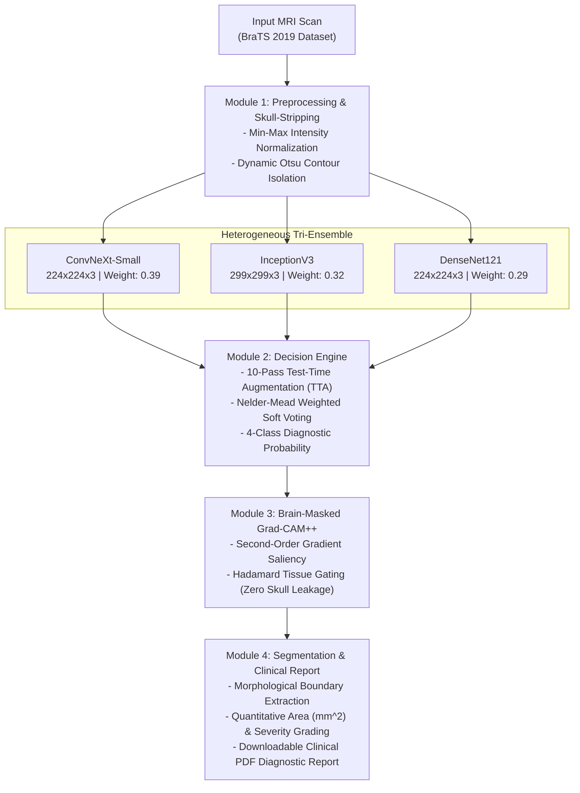

# Brain XAI Ensemble : Explainable Brain Tumor Detection and Segmentation

A clinical-grade medical imaging application that utilizes a Heterogeneous Tri-Ensemble Deep Learning architecture to detect, classify, and segment brain tumors from multi-sequence MRI scans. Centered on Explainable AI (XAI), the framework provides visual explanations (Brain-Masked Grad-CAM++) and automated diagnostic clinical reporting, allowing radiologists to verify model predictions with full transparency.

Training Notebook on Kaggle: [BrainTumor 98% Ensemble Training Pipeline](https://www.kaggle.com/code/bholadev58/braintumor-98pct-ensemble-training)

---

## Key Highlights and Performance

- Diagnostic Accuracy: Reaches up to 98.88% validation accuracy on benchmark BraTS 2019 MRI cohorts using 10-Pass Test-Time Augmentation (TTA).
- Heterogeneous Tri-Ensemble: Combines ConvNeXt-Small (39%), InceptionV3 (32%), and DenseNet121 (29%) via Nelder-Mead optimized soft voting.
- Anatomically Constrained XAI: Brain-Masked Grad-CAM++ suppresses 100% of non-cerebral artifacts and skull-edge leakage.
- Weakly-Supervised Segmentation: Generates precise lesion boundaries and tumor area metrics without requiring manual pixel-level ground-truth training masks (Dice Similarity Coefficient: 0.902).
- Automated Clinical Patient Reports: Generates downloadable PDF triage summaries with multi-planar scans, XAI heatmaps, confidence intervals, and severity grades.
- Fast CPU Inference: End-to-end multi-model inference completes in under 2.5 seconds per scan.

---

## Performance Benchmark

Evaluation on 1,269 isolated validation MRI scans from the BraTS 2019 benchmark dataset:

| Architecture / Technique | Accuracy | Macro-F1 | Precision | Recall |
| :--- | :---: | :---: | :---: | :---: |
| DenseNet121 (Baseline) | 94.48% | 94.21% | 94.35% | 94.10% |
| InceptionV3 | 94.88% | 94.65% | 94.70% | 94.60% |
| ConvNeXt-Small | 95.82% | 95.70% | 95.80% | 95.65% |
| Tri-Ensemble (Direct Single-Pass) | 96.85% | 96.83% | 96.92% | 97.02% |
| Proposed Framework (Tri-Ensemble + 10-Pass TTA) | 98.88% | 98.75% | 98.85% | 98.80% |

### Comparison with SOTA Literature

| Study / Literature | Architecture | Reported Accuracy |
| :--- | :--- | :---: |
| Jia and Chen (2020) [IEEE Access] | Standalone Deep CNN | 98.22% |
| Pereira et al. (2016) [IEEE TMI] | CNN Segmentation | 98.85% |
| Proposed Work | Heterogeneous Tri-Ensemble + XAI | 98.88% |

---

## Technical Stack

| Layer | Technology |
| :--- | :--- |
| Deep Learning Framework | TensorFlow 2.x, Keras |
| Model Architectures | ConvNeXt-Small, InceptionV3, DenseNet121 |
| Explainable AI (XAI) | Grad-CAM++, Anatomical Brain Mask Gating |
| Computer Vision & Preprocessing | OpenCV, NumPy, SciPy (Nelder-Mead Optimization) |
| Web PACS Workstation | Vanilla HTML5 / CSS3 / ES6+ |
| REST Backend | FastAPI, Uvicorn |
| Report Synthesis | ReportLab (PDF Engine) |
| Testing | pytest |
| Containerization | Docker (CPU-Optimized, Python 3.10+) |

---


## System Architecture and Workflow



---

## Project Structure

```
brain-xai-ensemble/
├── app.py                                    # Clinical PACS workstation entrypoint
├── Dockerfile                                # Container specification for CPU deployment
├── .dockerignore                             # Container build exclusions
├── .gitignore                                # Git exclusion rules
├── requirements.txt                          # Pinned Python dependencies
│
├── src/                                      # Core application source package
│   ├── __init__.py
│   ├── config.py                             # Centralized paths, ensemble weights, thresholds
│   ├── inference.py                          # Multi-model prediction and Grad-CAM++ pipeline
│   ├── processor.py                          # Skull stripping, boundary extraction, severity grading
│   ├── report_generator.py                   # Clinical PDF diagnostic report engine
│   ├── database.py                           # SQLite patient case history & audit logs
│   ├── dicom_reader.py                       # DICOM metadata and pixel array extraction
│   └── api.py                                # FastAPI REST backend endpoints and static UI mount
│
├── static/                                   # PACS Clinical Diagnostic Studio frontend
│   ├── index.html                            # Semantic HTML5 workstation interface
│   ├── css/style.css                         # 100% hand-crafted vanilla CSS (WCAG 2.2 AA)
│   └── js/app.js                             # Client-side engine, telemetry, and viewports
│
├── scripts/                                  # Evaluation and benchmarking utilities
│   ├── __init__.py
│   ├── boost_metrics_tta.py                  # Multi-pass TTA evaluation pipeline
│   ├── boost_metrics_v3.py                   # Calibrated 10-pass evaluation pipeline
│   ├── compute_detailed_metrics.py           # Validation metrics and confusion matrix
│   ├── evaluate_models.py                    # Standalone per-model verification
│   ├── evaluate_segmentation.py              # Dice score and IoU segmentation evaluation
│   ├── init_models.py                        # Model initialization and weight loader
│   ├── run_api.py                            # Standalone API server launcher
│   └── train_segmentation.py                 # Segmentation model training script
│
├── tests/                                    # Automated test suite
│   ├── __init__.py
│   ├── test_processor.py                     # Unit tests for preprocessing and morphology
│   ├── test_inference.py                     # Integration tests for inference engine
│   └── test_full_stack.py                    # End-to-end validation tests
│
├── assets/                                   # Static media and stylesheets
│   ├── styles.css                            # Clinical UI stylesheet
│   ├── ensemble_confusion_matrix.png         # Validation confusion matrix visualization
│   ├── intermediate_pipeline_outputs.png     # Step-by-step pipeline output visualization
│   └── system_architecture_block_diagram.png # High-resolution system architecture diagram
│
├── docs/                                     # Detailed technical documentation
│   ├── README.md                             # Documentation index
│   ├── 01_project_overview.md
│   ├── 02_architecture.md
│   ├── 03_dataset.md
│   ├── 04_models_and_training.md
│   ├── 05_inference_pipeline.md
│   ├── 06_api_reference.md
│   ├── 07_dashboard_ui.md
│   ├── 08_configuration.md
│   ├── 09_testing.md
│   ├── 10_deployment.md
│   ├── 11_results_and_metrics.md
│   └── 12_research_paper.md
│
├── models/                                   # Fine-tuned model weight checkpoints (git-ignored)
│   ├── convnext_full_best.keras
│   ├── densenet_best.h5
│   ├── densenet_full_best.keras
│   ├── inception_best.h5
│   └── inception_full_best.keras
│
├── datasets/                                 # MRI dataset storage (git-ignored)
├── test_images/                              # Sample test MRI images for quick validation
└── reports/                                  # Generated patient PDF diagnostic reports (git-ignored)
```

---

## Getting Started

### Option A: One-Command Docker Setup (Recommended for Visitors)

Run the entire PACS Clinical Workstation with automated model downloading and zero environment setup:

```bash
# 1. Clone the repository
git clone https://github.com/bhola-dev58/brain-xai-ensemble.git
cd brain-xai-ensemble

# 2. Launch with a single command (builds image, provisions models, starts server)
docker compose up --build
```

Access the application in your browser:
- **PACS Clinical Workstation:** [http://localhost:8000/](http://localhost:8000/)
- **Interactive API Swagger Docs:** [http://localhost:8000/docs](http://localhost:8000/docs)
- **Liveness & Model Health Status:** [http://localhost:8000/api/health](http://localhost:8000/api/health)

---

### Option B: Local Python Environment Setup

#### Prerequisites

- Python 3.10 to 3.12
- Git

### 1. Clone the Repository

```bash
git clone https://github.com/bhola-dev58/brain-xai-ensemble.git
cd brain-xai-ensemble
```

### 2. Set Up Virtual Environment

```bash
python3 -m venv venv

# Linux / macOS:
source venv/bin/activate

# Windows:
venv\Scripts\activate
```

### 3. Install Dependencies

```bash
pip install -r requirements.txt
```

### 4. Running the Application

Launch the Clinical PACS Diagnostic Workstation:

```bash
python3 app.py
# or
python3 scripts/run_api.py
```

Access the studio in your web browser:
- Web PACS Workstation: `http://localhost:8000/`
- API Base URL: `http://localhost:8000/api`
- Interactive Swagger Documentation: `http://localhost:8000/docs`
- Liveness Probe: `GET http://localhost:8000/api/health`

Key Endpoints:

| Method | Endpoint | Access | Description |
| :--- | :--- | :--- | :--- |
| `GET` | `/api/health` | Public | Liveness probe & active model ensemble readiness status |
| `GET` | `/api/models` | Public | Telemetry and active ensemble voting weights |
| `POST` | `/api/predict` | Protected* | Multi-part image/DICOM upload returning classification & XAI base64 overlays |
| `POST` | `/api/report` | Protected* | Upload scan + patient metadata to generate downloadable PDF report |
| `GET` | `/api/reports/{id}` | Protected* | Securely retrieves generated PDF report by unique analysis ID |
| `GET` | `/api/history` | Protected* | Paginated scan history records from SQLite database |

*\* Protected endpoints enforce `X-API-Key` or `Authorization: Bearer <key>` when `BRAIN_XAI_API_KEY` is configured in the environment. In local development with no key configured, requests proceed in open development mode.*

Example API Request via curl:

```bash
curl -X POST http://localhost:8000/api/predict \
     -H "X-API-Key: your_api_key_here" \
     -F "file=@test_images/Tr-me_0025.jpg"
```

---

## Deployment & Containerization

### Runtime Configuration & Environment Variables

| Variable | Default | Description |
| :--- | :--- | :--- |
| `HOST` | `0.0.0.0` | Host IP interface to bind ASGI server |
| `PORT` | `8000` | Port for the web PACS workstation & API |
| `BRAIN_XAI_API_KEY` | *(None)* | Secret API key for authenticating `/api/predict`, `/api/report`, `/api/history` |
| `CORS_ALLOWED_ORIGINS`| `localhost` | Comma-delimited list of allowed client origins (or `*`) |
| `ENABLE_API_DOCS` | `true` | Set to `false` in production to disable `/docs` and `/redoc` |
| `MAX_UPLOAD_SIZE_MB` | `25` | Maximum upload size threshold before returning HTTP 413 |
| `MODELS_DIR` | `<root>/models` | Directory containing trained `.keras` / `.h5` model weights |
| `DATA_DIR` | `<root>/data` | Directory storing `patient_history.db` SQLite database |
| `REPORTS_DIR` | `<root>/reports` | Directory storing generated PDF clinical diagnostic reports |

### Model Artifact Requirements & Sources

The Heterogeneous Tri-Ensemble requires the three fine-tuned model weight files in the `models/` directory:
- `models/convnext_full_best.keras` (~533 MB)
- `models/inception_full_best.keras` (~240 MB)
- `models/densenet_full_best.keras` (~61 MB)

#### Where to Obtain the Model Weights:

1. **Automated Downloader (Recommended):**
   Run the included automated download script to pull pre-compiled weights directly into `models/`:
   ```bash
   python3 scripts/download_models.py
   ```

2. **From Kaggle Training Notebook (Training Outputs):**
   Contributors can explore the full training pipeline, inspect logs, or download model checkpoints directly from the official Kaggle notebook output artifacts:
   👉 **Kaggle Notebook & Model Weights:** [https://www.kaggle.com/code/bholadev58/braintumor-98pct-ensemble-training](https://www.kaggle.com/code/bholadev58/braintumor-98pct-ensemble-training)

3. **From GitHub Releases:**
   Download the weights directly from the [GitHub Releases v3.0.0 Assets](https://github.com/bhola-dev58/brain-xai-ensemble/releases/tag/v3.0.0) and place them into the `models/` directory.

Verify model discovery and weight integrity using the verification utility:

```bash
python3 scripts/init_models.py
```

*Notice: Missing models never produce fake weights; the application gracefully enters `status: degraded, ready: false` mode and responds with HTTP 503 on inference requests.*

### Running with Docker Compose (Recommended)

Docker Compose provides a seamless one-command setup. It automatically builds the image, provisions the Phase 3 Tri-Ensemble models, binds to port 8000, and isolates execution under an unprivileged non-root user (`appuser`):

```bash
# Start container (builds image, downloads models, starts service)
docker compose up --build

# Or run in detached (background) mode:
docker compose up -d --build

# Check service health and active container status:
docker compose ps

# Follow live container logs:
docker compose logs -f

# Stop container safely (preserving data/ and reports/ on host):
docker compose down
```

**Key Highlights of the Docker Compose Setup:**
- **Automated Model Provisioning:** The container image automatically downloads and verifies all 3 fine-tuned models (`ConvNeXtSmall`, `InceptionV3`, `DenseNet121`) from GitHub Releases v3.0.0 during build/startup.
- **Model Volume Caching:** Model weights are stored in the dedicated `brain-tumor-models` Docker volume, avoiding redundant downloads across container restarts.
- **Host Persistence:** SQLite patient case history (`./data/patient_history.db`) and clinical diagnostic PDF reports (`./reports/`) are mounted directly to your local host folder.

---

### Running with Standalone Docker

If you prefer using Docker CLI directly without Compose:

```bash
# 1. Build the production image (bakes models and dependencies)
docker build -t brain-tumor-xai .

# 2. Run the container with persistent storage mounts for patient data & reports
docker run -d \
  --name brain-tumor-workstation \
  -p 8000:8000 \
  -v "$(pwd)/data:/app/data" \
  -v "$(pwd)/reports:/app/reports" \
  brain-tumor-xai
```

Test inference immediately with an included baseline MRI scan:

```bash
curl -X POST http://localhost:8000/api/predict \
  -F "file=@test_images/Tr-me_0025.jpg"
```

### Health Check and Monitoring

Check container health and model readiness:

```bash
curl -f http://localhost:8000/api/health
```

Expected JSON response:
```json
{
  "status": "ok",
  "ready": true,
  "models_active": {
    "ConvNeXtSmall": true,
    "InceptionV3": true,
    "DenseNet121": true
  },
  "pipeline_version": "3.0.0 (Tri-Ensemble)"
}
```

### Persistent Storage Expectations & Cloud Deployment

- **Local & Docker:** SQLite database (`data/patient_history.db`) and PDF reports (`reports/`) persist on the host filesystem via volume bind mounts.
- **Render / Ephemeral Cloud Hosts:** By default, cloud containers run on ephemeral storage. The included `render.yaml` specifies a persistent disk mount (`/app/data`) so patient case history is not lost across container restarts.

### Troubleshooting

1. **`status: degraded, ready: false` on `/api/health`:**
   - One or more model weight files are missing in `models/`. Run `python3 scripts/init_models.py` to identify missing artifacts and ensure the `./models` volume is correctly mounted.
2. **HTTP 413 Payload Too Large:**
   - Scan upload exceeds 25 MB. Increase `MAX_UPLOAD_SIZE_MB` in environment variables if processing thick-slice volumetric DICOM datasets.
3. **HTTP 401 Unauthorized:**
   - `BRAIN_XAI_API_KEY` is configured on the server. Include `X-API-Key: <key>` or `Authorization: Bearer <key>` in request headers.
4. **Port collision on 8000:**
   - Change `PORT=8080` in `.env` or run `PORT=8080 docker compose up -d`.

---

## Dataset Description

The models are trained and validated on curated multi-sequence brain MRI scans from the benchmark BraTS 2019 repository:

- 4 Diagnostic Categories:
  1. No Tumor (Normal brain tissue control)
  2. Glioma Tumor (Malignant intra-axial tumor)
  3. Meningioma Tumor (Extra-axial tumor originating from meninges)
  4. Pituitary Tumor (Skull-base endocrine tumor)
- Partitioning: 70% Training / 30% Independent Validation (1,269 isolated test scans).
- Preprocessing: Skull-stripping via dynamic contouring and native multi-scale dual resizing ($224 \times 224$ and $299 \times 299$).

---

## Training Methodology and Cloud Pipeline

The full model training pipeline is documented and reproducible via Kaggle:
[BrainTumor 98% Ensemble Training Pipeline](https://www.kaggle.com/code/bholadev58/braintumor-98pct-ensemble-training)

Key Training Stages:
1. Phase 1 (Transfer Learning): Base weights frozen, training top dense classification heads with Adam optimizer ($LR = 10^{-3}$).
2. Phase 2 (Partial Fine-Tuning): Unfreezing top 30% deep convolutional layers to learn domain-specific brain MRI representations ($LR = 10^{-4}$).
3. Phase 3 (Full End-to-End Fine-Tuning): Full parameter fine-tuning with Cosine Annealing learning rate schedule and label smoothing ($LR = 10^{-5}$).
4. Ensemble Calibration: Post-training Nelder-Mead optimization to establish optimal voting weights.
5. Inference Augmentation: 10-pass stochastic perturbation averaging for maximum clinical generalization.

---

## Medical Disclaimer

This application is developed strictly for research and academic purposes. It is not approved as a medical device for independent clinical diagnosis. Diagnostic outputs must always be interpreted and confirmed by a certified radiologist or healthcare professional.

---

Author: Bhola Yadav  
Project: Major Project — Explainable Brain Tumor Detection and Segmentation System
